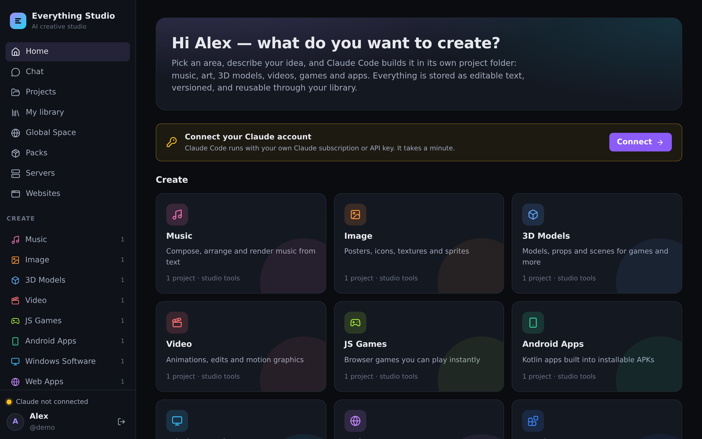
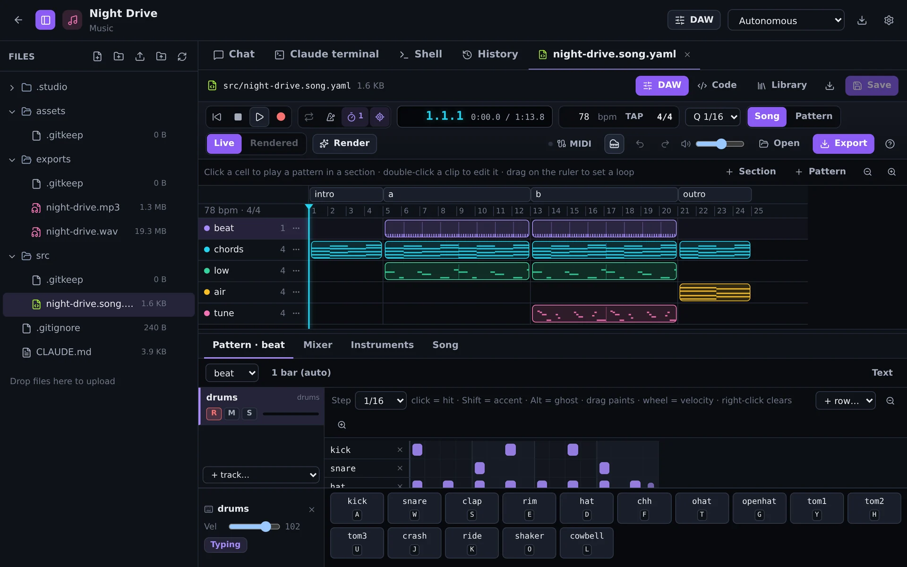
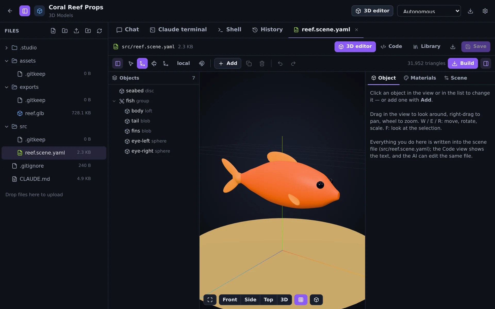
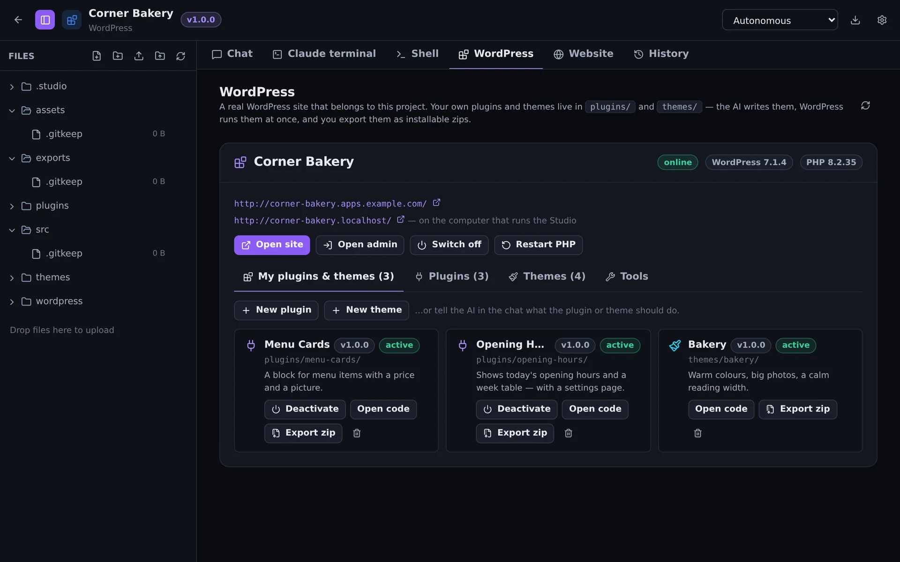
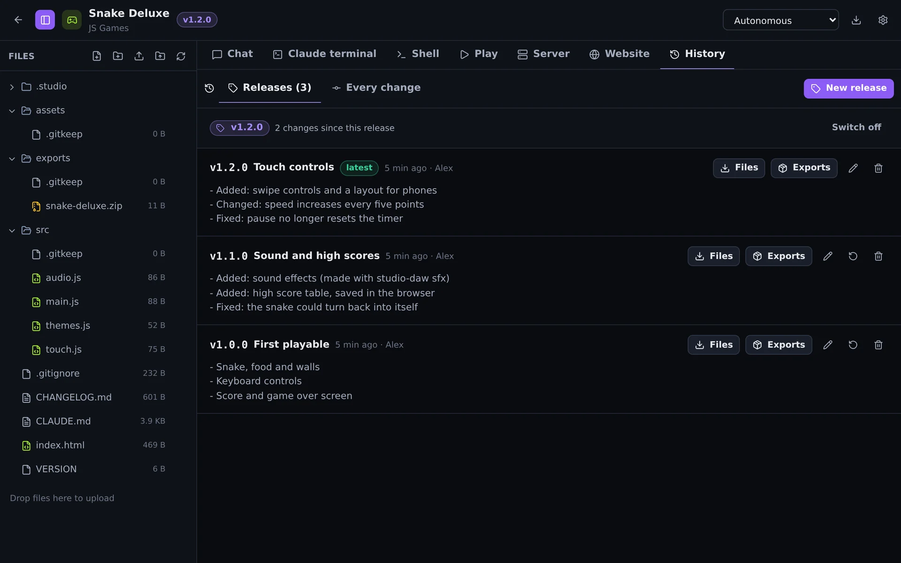
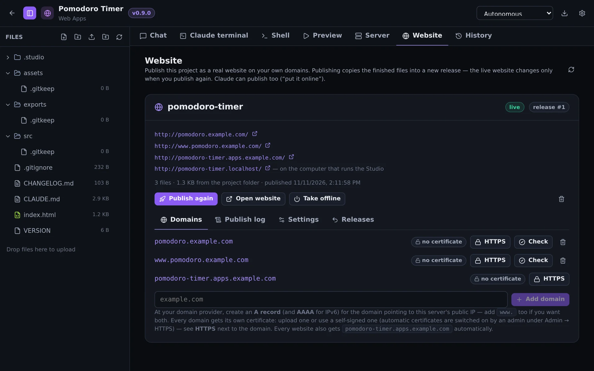
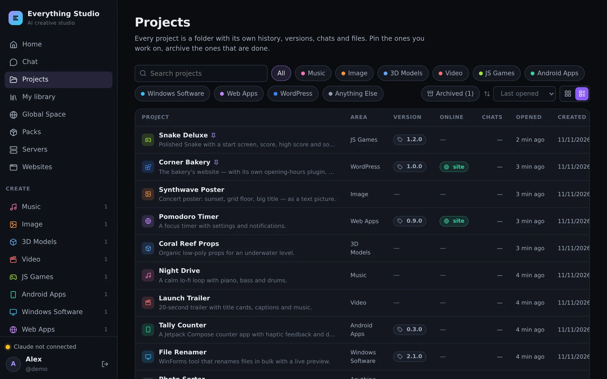

# Everything Studio (ai-everything)

> [!TIP]
> This project is actively maintained. Feature requests and bug reports are welcome via GitHub Issues and will be reviewed within 1–3 weeks.

> [!WARNING]
> ⚠️ CAUTION: This repository contains code developed with the assistance of Artificial Intelligence (AI). While functional, AI-generated code can introduce hidden bugs, security vulnerabilities, or logic flaws that may not be immediately apparent. Please thoroughly review, audit, and test all files in an isolated development environment before deployment, as this software is provided as-is and used entirely at your own risk.

> [!NOTE]
> ai-everything is independent open-source software. It is **not affiliated with or endorsed by Anthropic**, OpenAI, Google or the WordPress Foundation. Claude and Claude Code are trademarks of Anthropic, PBC. Claude Code is Anthropic's proprietary software and is **not included** in this repository or the image — see [Legal](#-legal-what-is-not-in-the-image).

## 🚀 Introduction

Everything Studio is a self-hosted creative workspace in **one Docker container**. People log in, pick what they want to make — a song, a picture, a 3D model, a video, a browser game, an Android app, a Windows program, a web app or a WordPress site — and an AI coding agent builds it in a project of its own, with **their own** AI account.



The container holds the website, text-driven creative software of its own (a DAW, a 3D tool, an image tool, a video editor and a stick-figure animator that the AI uses and can extend), every toolchain the AI needs, and the database. Creative work is stored as human-readable **text files** — songs, scenes, pictures and timelines you and the AI can read, edit, compare and version; audio, images and models are rendered from them.

It is built for more than one person: every user is a Linux account of their own inside the container, registration is closed by default, and web apps, games and WordPress sites go online on your own domains with HTTPS certificates that are requested and renewed by themselves.

📖 **Documentation with screenshots:** [https://bugfishtm.github.io/ai-everything/](https://bugfishtm.github.io/ai-everything/)

---

## 🔥 Features

### 🎨 Ten creative areas

Each area has its own project template, its own instructions for the AI and the tools that fit.

| Area | You get | Made with |
|---|---|---|
| 🎵 Music | Songs, loops, sound effects as WAV, MP3, MIDI, stems | `studio-daw` — songs as text, a DAW in the browser |
| 🖼️ Image | Posters, icons, textures, pixel art as PNG, JPG, WebP, ICO | `studio-image` |
| 🧊 3D Models | Props and scenes as .glb, .obj, .stl, .ply | `studio-3d` — scenes as text, a 3D editor |
| 🎬 Video | Trailers, slideshows, shorts, stick-figure animation as MP4 | `studio-video`, `studio-stickman` |
| 🎮 JS Games | Browser games, playable at once | HTML5, canvas, WebGL, three.js, Phaser |
| 📱 Android Apps | Installable APKs | Kotlin, Jetpack Compose, Gradle |
| 🪟 Windows Software | .exe programs and installers | .NET, C/C++ with mingw-w64, NSIS |
| 🌐 Web Apps | Websites and tools with a live preview | HTML, CSS, JavaScript, Vite |
| 🧩 WordPress | A running WordPress site, plugins, themes, blocks | PHP, WP-CLI, starters |
| ✨ Anything Else | Scripts, documents, research | Everything in the image |

### 🤖 Your own AI account

The Studio does not include an AI and does not resell one. Each person signs in to **Claude Code** with their own Claude subscription or API key. Administrators can switch on **OpenAI Codex**, **Google Gemini**, **OpenCode** or any agent that speaks the Agent Client Protocol — all with the same chat, approvals and saved versions.

### 🎹 A DAW for songs that are text



Open a `.song.yaml` file and it becomes a DAW: arrangement, piano roll, drum step grid, mixer, instruments. Play and **record** with a MIDI keyboard, the on-screen keys or your computer keyboard. Every edit changes only the touched lines of the file; the engine that renders the final mix also plays every note you hear. Export WAV, MP3, MIDI and stems.

### 🧊 A 3D editor for scenes that are text



Move, rotate and reshape objects in the view, assign materials and textures, build to `.glb`. The scene file stays the single source of truth — the AI edits the same text.

### 🧩 WordPress with your own plugins and themes



A WordPress project is a real site: installed with one click, with its own database, its own PHP and its own address. Your plugins, themes and blocks live next to it in the project — versioned, live at once, started from working starters, exported as installable zips. One tab manages the site: plugins, themes, updates, the PHP log, database exports, and a one-click sign-in to the admin area.

### 🏷️ Versions and releases



Every AI turn is saved in the project's git history and can be restored. **Versioning** — available in every area — adds numbers on top: patch, minor, major or your own, with notes, a `VERSION` file, a `CHANGELOG.md`, a git tag and a kept copy of the finished files.

### 🌐 Online with your own domains and HTTPS



Publish web apps and games as real websites, add your own domains, and get **one certificate per domain** — automatically from Let's Encrypt, uploaded, or self-signed. Projects can run their own **Node.js servers** for multiplayer, saves and APIs. No extra proxy needed; Caddy, nginx or a CDN in front work too.

### 🗂️ Projects you can find again



Cards or a list with details, search, sorting, pinned projects and an archive.

### 📚 Library, packs and skills

Save what you make as reusable assets, share them with everyone on the Studio, add packs of instruments, samples, models and materials, and teach the AI how you work with skills and standing instructions.

### 🛡️ Made for more than one person

One Linux account per user, sandboxed previews, websites on their own origins, confined PHP for WordPress sites, rate-limited logins, limits per user, an admin area — see the [security model](https://bugfishtm.github.io/ai-everything/config.html#security-model).

---

## 🗒️ Requirements

| Requirement | Value |
|---|---|
| Docker | Docker Desktop or Docker Engine with Compose v2 (v2.24+ for the public-server setup) |
| Processor | x86-64 (amd64) |
| Memory | 4 GB minimum, 8 GB or more recommended |
| Disk | About 15 GB |
| Internet connection | Required at the first start (Claude Code is downloaded) |
| Browser | A current Chrome, Edge, Firefox or Safari |
| AI account | Each user's own (Claude subscription or API key, or another AI the admin switched on) |

---

## 🛠️ Installation

### 🐳 Quick start

```bash
git clone https://github.com/bugfishtm/ai-everything.git
cd ai-everything
docker compose up -d
```

Compose takes the image [`bugfishtm/ai-everything`](https://hub.docker.com/r/bugfishtm/ai-everything) from Docker Hub (`docker compose up -d --build` builds it from this source instead — 10–30 minutes the first time). Open **http://localhost:8080** — the first account you create is the administrator. Then connect your AI under *Account & AI*.

No `.env` file is needed; copy `.env.example` to `.env` to change ports or limits.

Without Compose:

```bash
docker run -d --name ai-everything \
  -p 127.0.0.1:8080:8080 -p 127.0.0.1:8081:8081 -p 127.0.0.1:8443:8443 \
  --shm-size=1g --restart unless-stopped \
  -v studio-data:/data -v studio-db:/var/lib/mysql \
  bugfishtm/ai-everything:latest
```

### 🌍 Running on a public server

Everything needed is in the image: websites on ports 80/443, certificates from Let's Encrypt, and the Studio itself under its own domain.

```bash
cp .env.server.example .env      # then edit: STUDIO_DOMAIN, PUBLIC_URL, ACME_EMAIL, ADMIN_*
docker compose up -d
docker compose logs -f studio    # wait for "certificate for studio.example.com issued"
```

1. **DNS**: an A record (and AAAA for IPv6) for the Studio's host name; optionally a wildcard record on a separate domain (`*.apps.example.com`) so every site gets an address by itself.
2. **Firewall**: ports 80 and 443 open. The Studio's own port stays on the server.
3. **Start** as above and open `https://studio.example.com`.

Full guide — DNS, certificates, the first account, troubleshooting: [Server & HTTPS](https://bugfishtm.github.io/ai-everything/server.html).

### 🔀 Behind a reverse proxy

- **Caddy** ships with the repository: set `DOMAIN`, `PUBLIC_URL`, `TRUST_PROXY=true`, `SITES_HTTPS=true` and run `docker compose --profile https up -d`.
- **nginx or another proxy**: route the Studio's host name to port `8080` and every other host name to port `8081`, pass `Host`, `X-Forwarded-Proto`, `X-Forwarded-For` and WebSocket upgrades, switch buffering off, allow long timeouts and large uploads. A complete nginx configuration is in the [documentation](https://bugfishtm.github.io/ai-everything/server.html#behind-nginx-or-another-proxy).
- **Apache**: enable `proxy proxy_http proxy_wstunnel rewrite headers ssl`, one virtual host per port, a WebSocket rule for every path (not only `/ws`) and `RequestHeader set X-Forwarded-Proto "https"`:

  ```apache
  RewriteEngine On
  RewriteCond %{HTTP:Upgrade} websocket [NC]
  RewriteRule ^/(.*) ws://127.0.0.1:8080/$1 [P,L]      # 8081 in the websites' virtual host
  ProxyPreserveHost On
  RequestHeader set X-Forwarded-Proto "https"
  ProxyPass        / http://127.0.0.1:8080/ flushpackets=on
  ProxyPassReverse / http://127.0.0.1:8080/
  ProxyTimeout 3600
  ```

  In `.env`: `TRUST_PROXY=true`, `PUBLIC_URL=https://studio.example.com`, `COOKIE_SECURE=true`, `SITES_HTTPS=true`. Full virtual hosts: [Behind Apache](https://bugfishtm.github.io/ai-everything/server.html#behind-apache).

### 🔄 Updating and backups

```bash
docker compose pull && docker compose up -d     # update
./scripts/backup.sh                             # database + data volume → backups/<date>/
```

Everything persistent lives in two Docker volumes (`studio-data`, `studio-db`); they survive updates and `docker compose down`.

### 📖 Documentation

| Where | What |
|---|---|
| [Install](https://bugfishtm.github.io/ai-everything/install.html) | Requirements, first steps, updates, backup and restore |
| [Server & HTTPS](https://bugfishtm.github.io/ai-everything/server.html) | Public server, Let's Encrypt, Caddy, nginx, CDN |
| [Guide](https://bugfishtm.github.io/ai-everything/guide.html) | Using the Studio: projects, editors, versions, websites, WordPress, admin |
| [Configuration](https://bugfishtm.github.io/ai-everything/config.html) | Every setting, the database, the image build, the security model |
| [docs/MANUAL.md](docs/MANUAL.md) | The full technical manual |
| [docs/ARCHITECTURE.md](docs/ARCHITECTURE.md) | How it works inside |

---

## 📄 Legal: what is not in the image

- **Claude Code** is Anthropic's proprietary software. It is not in this repository and not in the image: every installation downloads the official package at the first start, and every person uses it with their own account under [Anthropic's terms](https://code.claude.com/docs/en/legal-and-compliance). The Studio never stores subscription credentials. Do **not** publish an image built with `INSTALL_CLAUDE_CODE=true`.
- **Other AIs** (OpenAI Codex, Google Gemini CLI, OpenCode) are downloaded unmodified when an administrator switches them on; their use is subject to each vendor's terms.
- **The Android SDK** is installed after an administrator accepted Google's license.
- **WordPress** is downloaded from wordpress.org when a site is set up.
- If you run the Studio **for other people**, the providers' terms for operators apply to you.

The software the image does contain, with its licenses: [docs/LICENSES.md](docs/LICENSES.md). Details: [docs/MANUAL.md](docs/MANUAL.md#legal-claude-code-android-sdk-and-publishing).

---

## 📁 Repository Structure

| Path | Description |
|---|---|
| .github/ | Issue and pull request templates, community files, the CI workflow. |
| _changelogs/ | HTML changelogs per version. |
| _images/ | Images used in this readme. |
| _licenses/ | Notes on third-party licenses. |
| _releases/ | Notes on releases (the software is released as a Docker image). |
| docs/ | The GitHub Pages website (`index.html` …) and the technical documents (`MANUAL.md`, `ARCHITECTURE.md`, `LICENSES.md`, `SOFTWARE.md`). |
| docker/ | Container entry point, database helpers, the Caddy configuration. |
| packs/ | Built-in packs: instruments, drums, synth presets, 3D materials and props. |
| scripts/ | Backup, update and migration scripts. |
| server/ | The Studio server (Node.js, TypeScript). |
| skills/ | Built-in skills — know-how the AI loads on demand. |
| templates/ | Project templates and AI instructions per area. |
| tools/ | The Studio's own software: `studio` CLI, `studio-daw`, `studio-3d`, `studio-image`, `studio-video`, `studio-stickman`, the headless browser. |
| web/ | The website (React, Vite). |
| [Dockerfile](Dockerfile) | The image. |
| [docker-compose.yml](docker-compose.yml) | The standard setup. |
| [docker-compose.server.yml](docker-compose.server.yml) | Additions for a public server (ports 80/443). |
| [.env.example](.env.example) · [.env.server.example](.env.server.example) | Example configurations. |
| [README.md](README.md) | This readme file. |
| [CHANGELOG.md](CHANGELOG.md) | Changelog. |
| [LICENSE.md](LICENSE.md) | License file (GNU General Public License v3.0). |
| [SECURITY.md](SECURITY.md) · [PRIVACY.md](PRIVACY.md) · [CONTRIBUTING.md](CONTRIBUTING.md) | Policies. |

---

## 💬 Support Channels

If you encounter any issues or have questions while using this software, feel free to contact us:

- **GitHub Issues** is the main platform for reporting bugs, asking questions, or submitting feature requests: [https://github.com/bugfishtm/ai-everything/issues](https://github.com/bugfishtm/ai-everything/issues)
- **Discord Community** is available for live discussions, support, and connecting with other users: [Join us on Discord](https://discord.com/invite/xCj7AEMmye)
- **Email support** is recommended only for urgent security-related issues: [security@bugfish.eu](mailto:security@bugfish.eu)

---

## 📢 Spread the Word

Help us grow by sharing this project with others! You can:

* **Tweet about it** – Share your thoughts on [Twitter/X](https://twitter.com) and link us!
* **Post on LinkedIn** – Let your professional network know about this project on [LinkedIn](https://www.linkedin.com).
* **Share on Reddit** – Talk about it in relevant subreddits like [r/selfhosted](https://www.reddit.com/r/selfhosted/) or [r/opensource](https://www.reddit.com/r/opensource/).
* **Tell Your Community** – Spread the word in Discord servers, Slack groups, and forums.

---

## 🌱 Contributing to the Project

Thank you for your interest in this project.

At this time, this repository is **not open for external contributions**.
Please do **not** submit pull requests or patches.

- Pull requests from external contributors are not accepted.
- Any unsolicited pull requests will be closed without review.
- All code in this repository is maintained by the project owner.
- By design, no third‑party code will be merged into this project via GitHub.

If you encounter a bug or have an enhancement suggestion, please check the "Issues" section of our GitHub repository or visit our official website for guidance before beginning any work on it.

---

## 🤝 Community Guidelines

We're focused on developing innovative solutions and advancing technology. By being part of this, you contribute to our progress.

Positive guidelines include being kind, empathetic, and respectful in all interactions. It is important to engage thoughtfully and offer constructive, solution-oriented feedback. Fostering an environment of collaboration, support, and mutual respect is essential.

Unacceptable behaviors include harassment, hate speech, or offensive language. Personal attacks, discrimination, or any form of bullying are not tolerated. Sharing private or sensitive information without explicit consent is strictly prohibited.

Together, we can partner to achieve common goals by following guidelines designed to promote effective collaboration and positive teamwork.

---

## 🛡️ Security Policy

I take security seriously and appreciate responsible disclosure. If you discover a vulnerability, please follow these steps:

- **Do not** report it via public GitHub issues or discussions. Instead, please contact the [security@bugfish.eu](mailto:security@bugfish.eu) email address directly.
- Provide as much detail as possible, including a description of the issue, steps to reproduce it, and its potential impact.

I aim to acknowledge reports within **2–4 weeks** and will update you on our progress once the issue is verified and addressed.

This software is provided as-is, without any guarantees of security, reliability, or fitness for any particular purpose. We do not take responsibility for any damage, data loss, security breaches, or other issues that may arise from using this software. By using this software, you agree that We are not liable for any direct, indirect, incidental, or consequential damages. Use it at your own risk.

---

## 📜 License Information

The license for this software can be found in the [LICENSE.md](LICENSE.md) file. The software may also include additional licensed software or libraries.

Everything Studio (ai-everything) — Copyright (C) 2026 The Everything Studio contributors. This program is free software: you can redistribute it and/or modify it under the terms of the **GNU General Public License, version 3**, as published by the Free Software Foundation. It is distributed in the hope that it will be useful, but WITHOUT ANY WARRANTY; without even the implied warranty of MERCHANTABILITY or FITNESS FOR A PARTICULAR PURPOSE.

- **What you make is yours.** The license covers the Studio itself, not the songs, pictures, models, games, apps and sites you create with it. The project templates and starter files the Studio copies into your projects are free to use without conditions (CC0-1.0); the WordPress starters are GPL-2.0-or-later, as is customary for WordPress plugins and themes. The built-in packs are CC0-1.0 (`gm-instruments`: MIT).
- **Third-party software** in the image and software downloaded at runtime (Claude Code, the Android SDK, WordPress, other AI agents) keep their own licenses — see [docs/LICENSES.md](docs/LICENSES.md).

🐟 Bugfish
